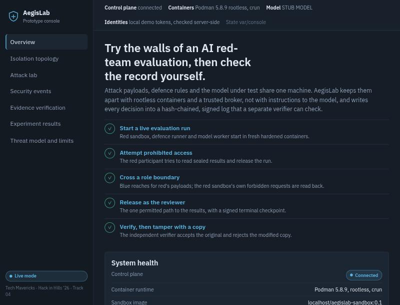
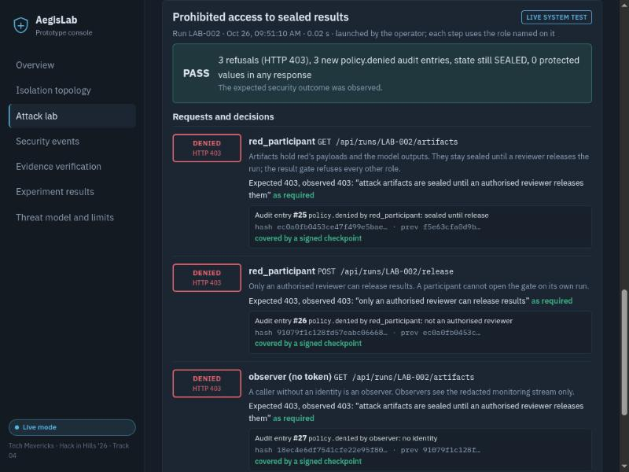
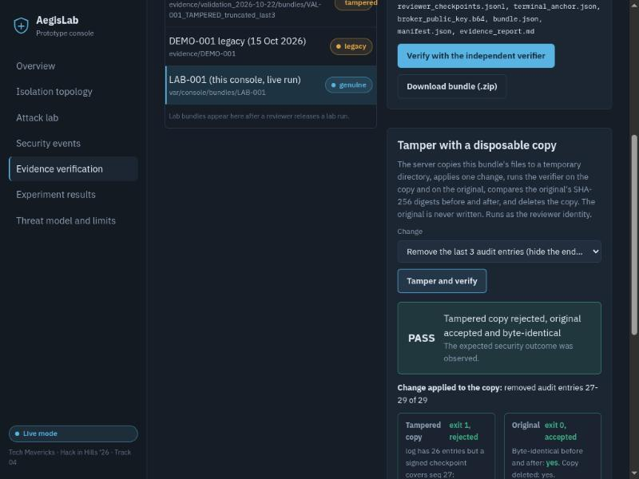

# AegisLab prototype console: user guide

The prototype console is an interactive web app on top of the existing AegisLab control plane. From a browser you can start a real evaluation run in rootless containers, attack its boundaries with fixed scenarios, watch the security events, verify the signed evidence with the independent verifier, and break a copy of it to see the verifier refuse it.

It runs on your own machine and answers on loopback only. It is a local demonstration tool, not a hosted service.



## Requirements

The requirements are the same as for the rest of the prototype (see the root `README.md`):

- Linux with **rootless Podman** and cgroups v2. It has been tested on one Fedora host (kernel 7.2, Podman 5.8.9, crun, SELinux enforcing).
- Python 3.11 or newer.
- Network access the first time only, for PyPI and the `python:3.12-slim` base image.

If Podman is missing, not rootless, or the sandbox image cannot be built, the console still starts, in **degraded mode**. The evidence centre, experiment results and a recorded replay still work. Live runs and the containment probe are refused with the reason shown.

## Start it

```bash
cd aegislab
bash scripts/start_prototype.sh
```

Then open **http://127.0.0.1:8400** in a browser. Press Ctrl-C to stop it; the launcher removes any lab containers it started.

| Option | Effect |
|---|---|
| `--port N` | listen on 127.0.0.1:N instead of 8400 (1024 to 65535) |
| `--check` | check the prerequisites, print LIVE or DEGRADED, and exit without starting |
| `--reset` | delete the console's state directory (`var/console`) before starting, for a clean run list |
| `--help` | usage |

The launcher:

- creates `.venv/` if needed;
- checks Podman and builds `localhost/aegislab-sandbox:0.1` if needed;
- writes all runtime state to `aegislab/var/console/`, which is git-ignored and separate from `var/` used by `quickstart.sh`;
- unsets any `AEGIS_MODEL_*` variables, so the console always uses the deterministic **stub** model;
- binds uvicorn to `127.0.0.1` only.

The equivalent manual command is:

```bash
AEGIS_VAR=var/console AEGIS_DEMO_MODE=1 .venv/bin/uvicorn aegis.console:app --host 127.0.0.1 --port 8400
```

## The pages

| Page | What it does | Result label |
|---|---|---|
| **Overview** | System health: control plane, Podman, sandbox image, model mode, the latest run's lifecycle and the integrity of the latest terminal run. It also verifies the shipped DEMO-001 bundle and shows a guided path through the demo, recent refusals, the lab journal and the main limits. | LIVE SYSTEM TEST |
| **Isolation topology** | A diagram of red sandbox, trusted broker, defence runner, model worker, result gate, audit log and verifier. Select a component to see its role, trust assumptions, permitted and denied operations, controls and evidence. The diagram states that all components share one host kernel and that the broker is trusted. | — |
| **Attack lab** | Start a live run, then run the four scenarios against it. You can also send one request yourself with any role's token. If live execution is impossible, the page shows the recorded judge-demo transcript, labelled REPLAY. | LIVE SYSTEM TEST / RECORDED EXECUTION |
| **Security events** | The redacted monitoring stream of every run, with filters (run, actor, event type, decision), polling every 2 s and a detail drawer. It shows no payloads, model outputs or defence rules. | LIVE |
| **Evidence verification** | Pick a bundle and run `python -m aegis.verify_cli` on it as a separate process. You can also tamper with a disposable copy, download a genuine bundle, or run the 12 in-memory tamper modes on a released run. | LIVE SYSTEM TEST |
| **Experiment results** | Real-model (Qwen2.5-0.5B) and timing results from saved runs. Each figure is recomputed from the raw files on request, and the page says how many checks agree. | PRECOMPUTED REAL-MODEL EVIDENCE / STUB-MODEL TEST |
| **Threat model and limits** | What was tested, what was not, and which components are trusted. | — |

## Running the scenarios

1. On **Attack lab**, choose the timing padding and press **Start a live run**. The operator identity creates, freezes and starts `LAB-001` through the real API. The red sandbox, defence runner and model worker run in fresh rootless containers. With the stub model the run was SEALED within about 5 seconds on the test host.
2. With the run SEALED, run the scenarios in this order:

   | Scenario | What happens | PASS means |
   |---|---|---|
   | **Prohibited access to sealed results** | The red participant reads the sealed artifacts and tries to release the run; an anonymous caller reads the artifacts. | 3 × HTTP 403; 3 new `policy.denied` audit entries; the run is still SEALED; 0 protected values (canary, payloads, model outputs, tokens, key header) in any response |
   | **Cross-role isolation** | Blue reads red's payloads; blue and the reviewer view the run; a forged token is used; the red sandbox's own forbidden mailbox requests are read back. | blue refused (403) and logged; secret digests hidden from blue and shown to the reviewer; forged token 401; 5 broker denials of the red sandbox |
   | **Authorised release** | The reviewer releases the run. This needs a two-step confirmation, because release cannot be undone. | HTTP 200; `run.released` by the reviewer in the audit log; strict verification ok with a terminal checkpoint; commitments verified; bundle exported |
   | **Sandbox containment** | A fresh container with the red sandbox's exact hardening flags runs a fixed probe: network, DNS, root-filesystem write, capabilities, foreign paths, and attacks on its own mailbox. Then the broker's real write routine replies into that mailbox. | every connection and write refused; CapEff 0; NoNewPrivs 1; seccomp mode 2; replies delivered as regular files; victim file intact |

3. The run is now RELEASED, so the first three scenarios refuse to run on it (HTTP 409). Start a new run to repeat them.

Each result shows every request, its expected and observed HTTP status, the policy explanation and the audit entry it created. The audit entry shows its sequence number and hash, and whether a signed checkpoint covers it.



## Verifying evidence



- **Shipped bundles:**
  - DEMO-001 (closeout) and VAL-001 must verify (exit 0).
  - VAL-001 TAMPERED and the legacy DEMO-001 must fail (exit 1).
  - The page shows whether the result matches that expectation.
- **Lab bundles:** a released `LAB-nnn` appears automatically. It is verified with the broker key pinned and the terminal hash recorded at release.
- **Tamper:** seven changes are available:
  - truncate the tail;
  - edit, delete or reorder an event;
  - rewrite an outcome and recompute the hash chain;
  - forge the anchor signature;
  - substitute the public key.

  The server copies the bundle's allowlisted files to a temporary directory and changes the copy. It verifies both the copy and the original, compares the original's SHA-256 digests before and after, then deletes the copy. The original is never written.
- **Download:** a zip of the allowlisted bundle files plus `VERIFY.txt` with the command to verify it elsewhere. Only genuine bundles are offered.

## Security of the console itself

- **Loopback only.** uvicorn binds to 127.0.0.1. Requests whose Host header is not a loopback name are refused with HTTP 421, which stops DNS-rebinding pages from calling the console.
- **Demo identities.** The browser receives the four role tokens from `GET /api/demo/identities`. The existing control plane serves that endpoint only when `AEGIS_DEMO_MODE=1`, which the launcher sets.

  Anyone who can reach the port can therefore act as any role. This is acceptable only on a single-user machine, which is why the console must not be exposed beyond loopback.
- **No free-form input to privileged code.**
  - Scenario ids, bundle ids and tamper modes are dictionary keys.
  - Run ids must match `LAB-nnn` and exist.
  - Request bodies with unknown fields are rejected (422).
  - Bodies over 256 KiB are rejected (413).
  - Nothing from the browser becomes a shell command, a path, a container option or a network target.
- **State-changing lab actions need the right role.**
  - Starting a run and running a scenario need the operator token.
  - Tampering needs the reviewer or operator token.
  - Only one state-changing lab action runs at a time (409 otherwise).
  - At most two verifier processes run at once (429 otherwise).
- **Security headers.** The console sets a CSP of `default-src 'self'`, with no inline script and `frame-ancestors 'none'`. It also sets X-Frame-Options DENY, nosniff, no-referrer and no-store.
- **API docs.** The interactive API docs (`/docs`, `/redoc`, `/openapi.json`) are not served.
- **Unchanged control plane.** The broker, sandbox flags, result gate, audit log and verifier are unchanged. The console calls them; it does not reimplement them.

## Troubleshooting

| Symptom | Cause and fix |
|---|---|
| `DEGRADED` at start, "podman is not installed" | Install Podman, or use the evidence centre and replay only |
| `DEGRADED`, "not running rootless" | AegisLab never runs containers as root. Run as a normal user with a rootless Podman setup |
| "sandbox image ... is not built yet" | Run the launcher without `--check`; it builds the image from `aegislab/Containerfile` (needs network the first time) |
| "port 8400 is already in use" | `--port 8410`, or stop the other process |
| HTTP 421 in the browser | Open `http://127.0.0.1:8400` or `http://localhost:8400`. Other host names are refused by design |
| "lab run limit (40) reached" | Restart with `--reset` |
| A scenario says "needs a SEALED run" | The selected run is still RUNNING or already RELEASED. Wait, or start a new run |
